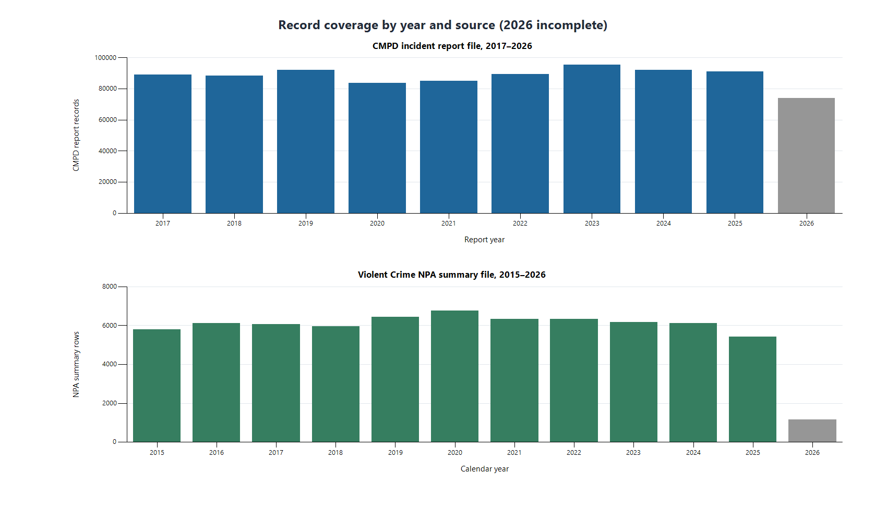
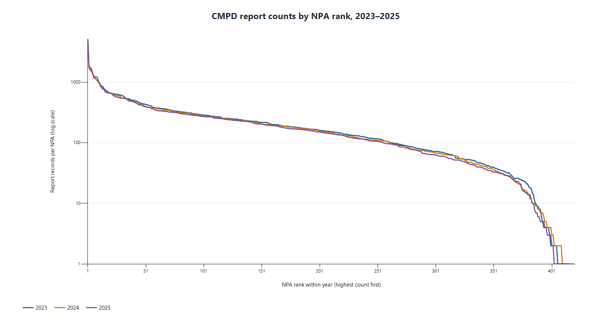
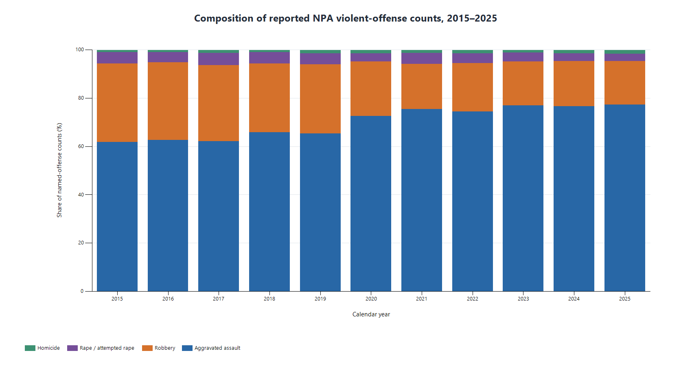
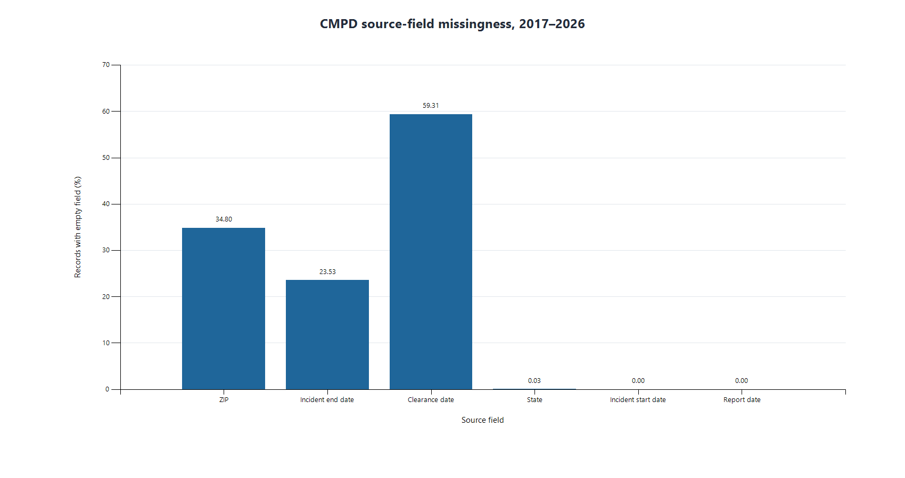

# Rated for Whom? Auditing Neighborhood Safety Scores in Charlotte

**D2 data note | November 2026**

## Purpose and observation units

This project examines how reported incident data, geographic assignment, time windows, and offense definitions can change the picture presented by a neighborhood safety score. It does not assume that any score is objectively correct, and these files do not measure all events that occurred. No score or model has been built for D2.

The two sources have different observation units. `CMPD_Incidents.csv` has one incident-report record per `INCIDENT_REPORT_ID` (880,471 rows, 29 source fields; report dates 2017-01-01 to 2026-10-30). `Violent_Crime_Data.csv` has one reported count per geography, year, month, and offense category (80,098 rows, 8 source fields; 2015-01 to 2026-03). The latter is already aggregated. They are analyzed separately because NPA boundary vintage, incident/report time basis, and a crosswalk from the highest CMPD NIBRS code to the summary categories remain unverified.

## Preparation and coverage

- CMPD: all 880,471 reports remain in the clean file. Dates are parsed into derived date fields; original values remain. The extract's `YEAR` matches report-date year for every row, while 22,859 rows differ from incident-start year. `Open` is retained and does not mean invalid; `Cleared` does not mean confirmed criminality. Flags identify 30,714 `Unfounded` rows, 84,239 rows whose highest description is `Other Unlisted Non-Criminal`, and 7,758 rows in both groups. These groups were not dropped.
- Violent Crime: `ROW_TYPE = Neighborhood Profile Area` leaves 68,705 rows and 418 distinct NPA IDs; 11,393 other-geography rows are outside this NPA file. Broad `Violent Crime`, named offenses, and `Non-Fatal Gunshot Injury` are tagged separately. In all 24,155 NPA-month groups containing both broad and named categories, the broad count equals the named-offense sum **excluding** the gunshot-injury indicator. These levels are not added together. Absent groups are not filled with zero.

The field-level definitions and transformations are in [data_dictionary.csv](data_preparation/data_dictionary.csv). The [cleaning log](data_preparation/cleaning_log.csv) records rows before and after every rule.

**Figure 1. Source coverage by year.** CMPD report rows and Violent Crime NPA summary rows have different units and are shown in separate panels. Gray 2026 bars are incomplete: CMPD reports extend through October 30; the NPA summary has January-March only. Row coverage is not comparable offense volume.

<!-- PAGE BREAK -->

## What the exploratory plots show

**Figure 2. CMPD report counts by NPA rank, 2023-2025.** The highest-count 10% of observed NPAs account for 41% of plotted 2025 reports; the median NPA has 144. Each year is ranked independently on a logarithmic count axis. These are report counts without population or exposure denominators, and the plot retains reports flagged as unfounded or noncriminal.

**Figure 3. Named-offense composition, 2015-2025.** Aggravated assault forms the largest share of the reported NPA named-offense counts. The broad subtotal and gunshot-injury indicator are excluded. The stacked percentages describe category mix, not overall volume; 2026 is omitted because only January-March are present. Boundary coverage and official category definitions remain unverified.

<!-- PAGE BREAK -->

## Quality and interpretation limits

**Figure 4. CMPD field missingness, 2017-2026.** `CLEARANCE_DATE` is empty for 59.31% of records, ZIP for 34.80%, and `DATE_INCIDENT_END` for 23.53%. Blank end or clearance dates may be inapplicable for some reports; they do not by themselves make a report invalid. The plotted period includes incomplete 2026.

**Data quality.** The preparation audit flagged 63 incident-start years, 9 incident-end years, and 4 clearance years before 1900; 9 rows have an end date before the start. Twenty-four CMPD rows have a zero, negative, or nonnumeric NPA. These records remain with flags rather than silent repairs. Duplicate-key, invalid-count, and unexpected-category checks passed on the prepared extract.

**Reporting and sampling.** CMPD rows represent reports and selected highest NIBRS classifications, not all events or every offense on a report. Reporting, enforcement, classification, and geocoding can vary by place and time. Neither file is a probability sample of all events. The summary may omit zero-count geography/month/offense groups; omission is not interpreted as zero.

**Geography and denominators.** CMPD has 451 distinct source NPA values; the NPA summary has 418 IDs. Boundary vintages and assignment rules have not been supplied. Population or exposure denominators are not available in this repository, so counts are not rates. No CMPD-versus-summary comparison was made.

## Temporal holdout decision

**Final cutoff for future source-specific modeling: 2025-01-01.** Periods through 2024-12-31 are development data; calendar year 2025 is the reserved temporal test period; 2026 is excluded because its coverage is incomplete and differs by source. For CMPD this split uses the observed report-date/`YEAR` agreement in this extract; the summary uses `CALENDAR_YEAR`. This is a project design decision, not a source-defined rule. The 2025 period appears in descriptive EDA, but **no exploratory model fitting, hyperparameter tuning, or test-set performance evaluation has occurred**, so test data were not used for modeling or tuning. Any future analysis must preserve the holdout and revisit it if source completeness changes.

**Unresolved assumptions:** NPA boundary equivalence, offense counting rules, whether omitted summary groups mean zero or unavailable data, and the completeness of nominally full years require source documentation. The [source audit](source_audit/source_audit_report.md), [preparation report](data_preparation/preparation_report.md), and [EDA report](d2_eda/D2_EDA_report.md) contain the supporting counts and checks.
