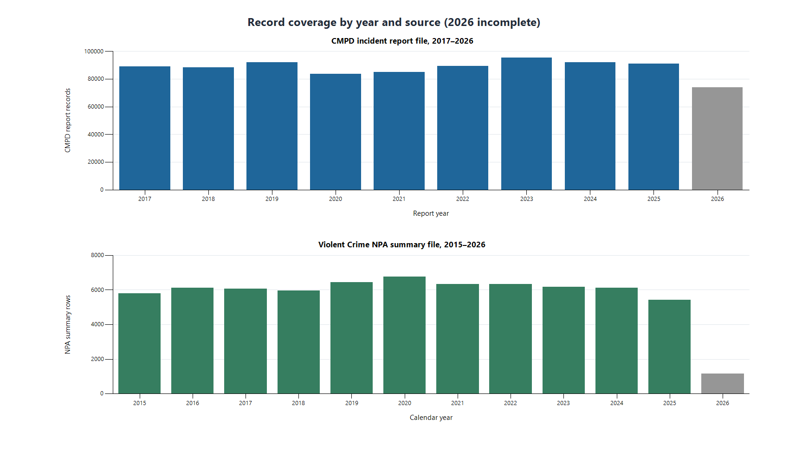
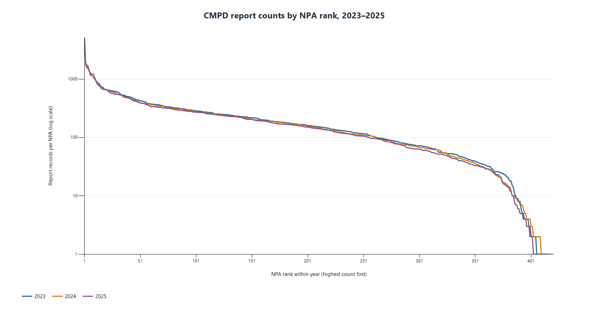
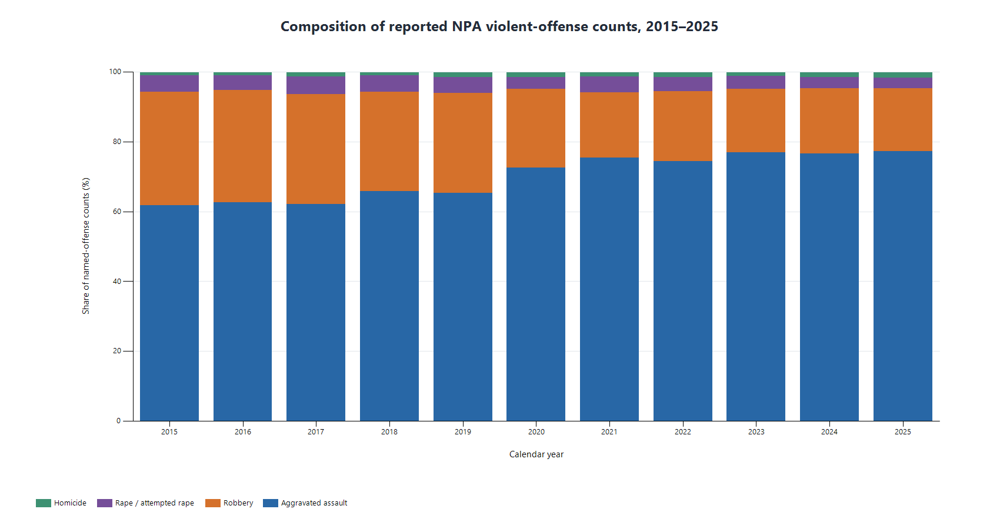
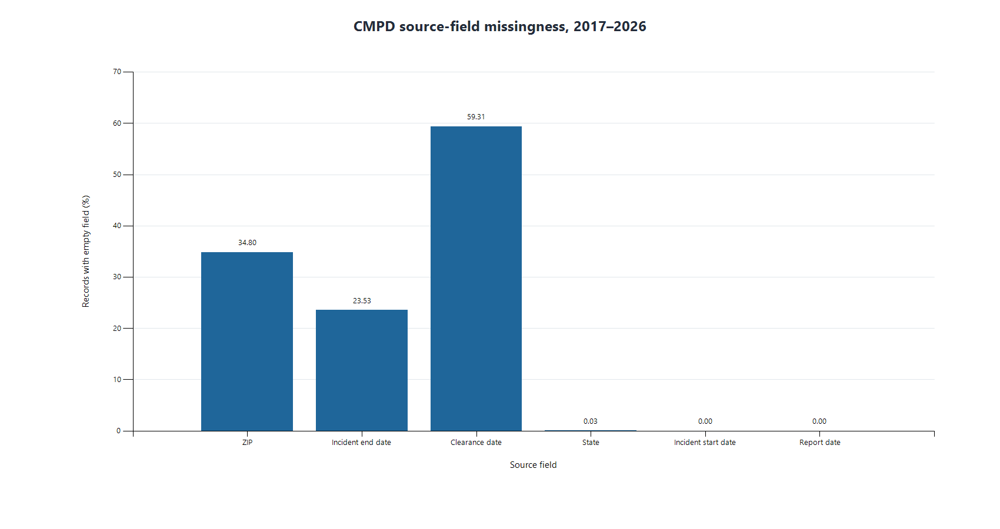

# D2 exploratory data analysis

These plots use the prepared source files, with no model or safety label. A "record" in the CMPD file is an incident report row; a row in the Violent Crime file is an already aggregated NPA/month/offense observation. The two sources are shown separately because NPA boundary vintage, common timing, and offense crosswalks have not been verified. Plot data and the script are in this folder.

Reproduce from the project root with: powershell -ExecutionPolicy Bypass -File .\d2_eda\make_eda_plots.ps1

## 1. Record coverage by year and source

**Title:** Record coverage by year and source (2026 incomplete). **Axes/units:** X = year; Y = CMPD report records (top panel) or Violent Crime NPA summary rows (bottom panel). **Source/date range:** cmpd_incidents_clean.csv, 2017-01-01 to 2026-10-30; violent_crime_npa_clean.csv, 2015-01 to 2026-03. Gray 2026 bars are incomplete: CMPD reports run through October 30, while the NPA summary has January–March only.

**Interpretation:** The files cover different starting years and have sharply different 2026 coverage. The bar heights show how many rows are available, not comparable offense volume.

**Limitation:** Row units differ across sources, and the summary may omit zero-count groups; the panels must not be read as a rate or cross-source comparison.

## 2. CMPD report-count distribution across NPAs

**Title:** CMPD report counts by NPA rank, 2023–2025. **Axes/units:** X = rank of observed NPA within each year; Y = report records per NPA, logarithmic scale. **Source/date range:** cmpd_incidents_clean.csv, report years 2023–2025. Only positive numeric NPA identifiers are plotted; 3 rows with other NPA values in those years were excluded from this plot.

**Interpretation:** Counts are strongly uneven across NPAs. In 2025, the highest-count 10% of observed NPAs account for 41% of plotted report records; the median NPA has 144 records.

**Limitation:** These are report counts without population or exposure denominators; they retain rows flagged as unfounded or noncriminal in the prepared file. NPA boundary comparability over time is unverified. The ranking changes independently each year and does not identify the same NPA across curves.

## 3. NPA violent-offense composition over time

**Title:** Composition of reported NPA violent-offense counts, 2015–2025. **Axes/units:** X = calendar year; Y = percent of summed named-offense counts. **Source/date range:** violent_crime_npa_clean.csv, NPA rows for 2015–2025. The broad Violent Crime subtotal and Non-Fatal Gunshot Injury indicator are excluded; 2026 is omitted because it contains January–March only.

**Interpretation:** Aggravated assault makes up the largest share of reported named-offense counts across these years. The chart shows category mix rather than the overall count level.

**Limitation:** Summing reported NPA counts assumes their geographic coverage is suitable for this description; boundary vintage, omitted zero groups, and official category definitions are not yet documented. It does not establish a population-adjusted rate.

## 4. CMPD source-field missingness

**Title:** CMPD source-field missingness, 2017–2026. **Axes/units:** X = source field; Y = percent of report records with an empty CSV field. **Source/date range:** cmpd_incidents_clean.csv, report dates 2017-01-01 to 2026-10-30, including incomplete 2026.

**Interpretation:** Clearance date is empty in 59.3089% of records, ZIP in 34.7974%, and incident end date in 23.5323%. The prepared file retains these blanks and records separate date-quality flags.

**Limitation:** An empty clearance or end date may be structurally inapplicable for some reports; this chart does not treat missingness as evidence of an invalid record.

## Comparison decision

No CMPD-versus-summary comparison plot was produced. The source audit and preparation report still list unresolved NPA boundary, time-basis, and offense-definition questions. The files remain separate, and no absent group was filled with an invented zero.
