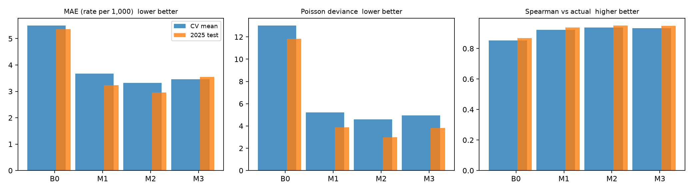
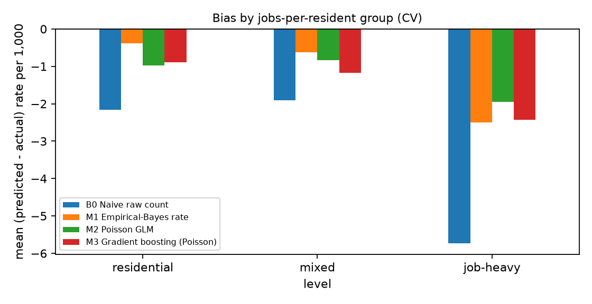

# D3 Modeling Note: Rated for Whom? Auditing Neighborhood Safety Scores in Charlotte

## Task and setup
**Question.** Does a score that corrects for residents and for reporting reliability predict next year's reliably-reported crime per resident better than the naive raw-count score that rating sites resemble?

**Unit and target.** One Neighborhood Profile Area (NPA) in one year *t*. Target: next-year (*t*+1) CMPD reports of motor vehicle theft, burglary/B&E and robbery per 1,000 residents. This is the least-biased available reference, not "true crime." Unfounded and non-criminal records (overdoses, missing persons, deaths, etc.) are dropped.

**Features (year *t* and earlier only).** Prior-year counts by offense group (reliable / other property / other violent / discretionary-enforcement), discretionary share, log population, log jobs-per-resident (daytime-exposure proxy), log density, and the prior-prior-year reliable rate. 453 NPAs with at least 500 residents; one fixed boundary set (City Quality of Life profile polygons, population 2020, jobs 2022).

**Validation (identical for every model).** Rolling-origin temporal CV: for target years 2021-2024, fit only on rows whose *target* year is earlier, predict the next. Model selection uses CV only. The reserved 2025 target year was scored once, after selection. `evaluate.py` asserts no training row's target year reaches the test year.

## Models
| ID | Model | What it corrects |
|---|---|---|
| B0 | Naive: last year's raw total count (rescaled by one fitted constant for MAE) | nothing |
| M1 | Empirical-Bayes: last year's reliable rate shrunk toward the city rate (gamma-Poisson; strength tuned on training data) | residents, small-count noise, reporting reliability |
| M2 | Poisson GLM, log(residents) exposure offset, all prior-year features | residents, daytime exposure, reliability |
| M3 | Gradient boosting, Poisson loss, weighted by residents; small grid tuned inside training years | same, non-linear |

## Results
Mean over 4 CV folds (2025 test in parentheses):

| Model | MAE (rate/1,000) | Poisson deviance | Spearman vs actual | Top-10% precision/recall |
|---|---|---|---|---|
| B0 Naive count | 5.50 (5.36) | 13.03 (11.84) | 0.853 (0.868) | 0.42 (0.38) |
| M1 Empirical-Bayes | 3.67 (3.23) | 5.21 (3.89) | 0.922 (0.938) | 0.66 (0.71) |
| **M2 Poisson GLM** | **3.32 (2.96)** | **4.59 (3.00)** | **0.938 (0.951)** | **0.64 (0.73)** |
| M3 Gradient boosting | 3.46 (3.55) | 4.96 (3.83) | 0.934 (0.948) | 0.63 (0.67) |

"Top-10%" is the highest-10% tier of NPAs, standing in for a "bottom grade" label; precision equals recall because the tiers are the same size.

**Selected model: M2 Poisson GLM**, chosen by lowest mean CV Poisson deviance among the candidates (decided before touching 2025). It also had the lowest CV MAE and the highest CV rank correlation. It is simple and interpretable, and the more flexible gradient boosting model did not beat it, which is reasonable with only ~450 areas and 4 folds; M3 was clearly worse on the 2025 test. The gap between B0 and every other model is large and consistent across folds; the gap among M1-M3 is small, so we do not claim M2 is decisively better than M1.

**Rank stability against the naive score.** Models M1-M3 correlate 0.86-0.90 with the naive ranking, and 22-27 of the ~45 NPAs in the top-10% tier differ from the naive tier. A tier label changes for roughly half of the labeled areas depending on the method choice.

## Error analysis by group
Groups are terciles of population size, jobs per resident (residential / mixed / job-heavy), and median household income (City QOL data).

- **Naive over-labels large-population NPAs and misses small ones.** B0 places 20.5% of large NPAs in the top-10% tier versus 6.1% that are actually there; small NPAs are flagged 3.1% versus 16.3% actual. Per-resident correction removes this: M2 flags 6.8% / 16.4%, close to the actual 6.1% / 16.3%. This is the clearest effect of the population correction.
- **Job-heavy areas have the largest errors for every model** (M2 MAE 4.4 versus 2.6 residential) and are under-predicted (mean error -1.9). Visitor and commuter traffic is not captured by a jobs count, consistent with the risk named in the proposal.
- **Income.** All models under-predict low-income NPAs (M2 mean error -1.7, MAE 5.0) and are most accurate in high-income NPAs (MAE 1.3). M2 flags 23.0% of low-income NPAs against 20.4% actual, and 0.3% of high-income NPAs against 0.9% actual: the corrected model still leans toward labeling lower-income areas, and its errors are largest where scores matter most. This should be read as a limit of the method, not as a statement about those neighborhoods.
- Across groups the mean error is negative (under-prediction), partly because rates are right-skewed and the model predicts conditional means.

## Limitations
- No ground truth for crime exists. The target is reliably-reported crime; it still reflects policing and reporting, and a model that predicts it well is not proof the score is "correct." We report how rankings depend on method, not which neighborhoods are safe.
- Reliability groups (vehicle theft, burglary, robbery) rest on national victimization-survey patterns and a name-matching rule (`offense_groups.py`); Charlotte may differ. We did not yet test alternative groupings.
- Population is a single 2020 estimate and jobs a single 2022 estimate applied to all years, and jobs omit shoppers, students and visitors. NPA boundary vintage was not verified; we drop 4 NPAs under 500 residents.
- Only 4 CV folds, one test year, ~450 areas: differences among M1-M3 are within plausible noise. Accuracy was not stress-tested under a different top-tier cutoff.
- The data are public, aggregated, and used only at NPA level. Results should not be generalized beyond Charlotte.

## Reproduce
`bash d3_modeling/run_all.sh` (fetches City data, runs `evaluate.py`). Outputs are in `d3_modeling/results/`. Fetched CMPD yearly totals match the D2 aggregates within 0.1% (`fetch_cmpd.py` prints the reconciliation).
